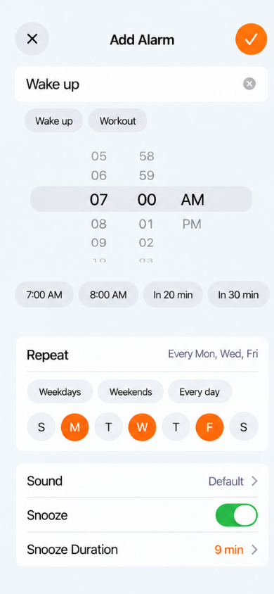
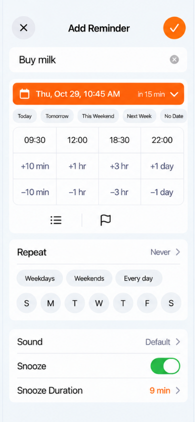
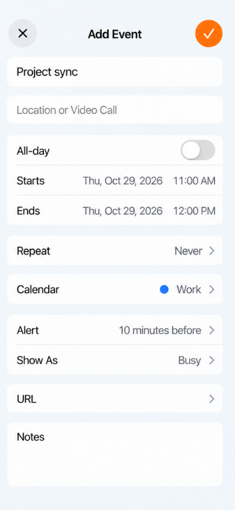
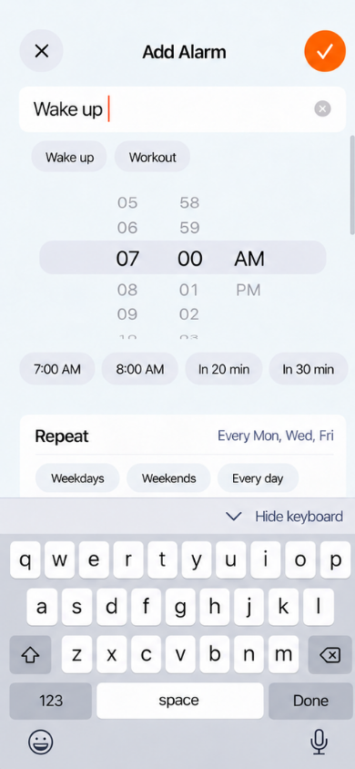
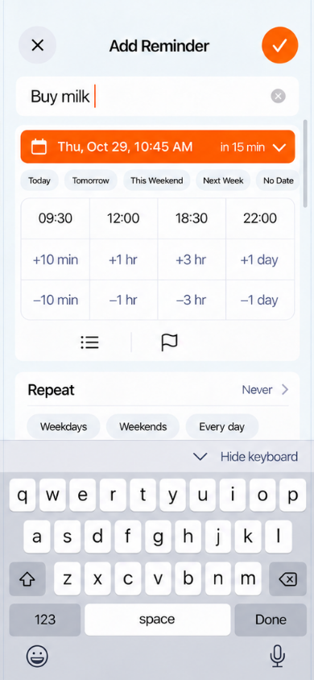
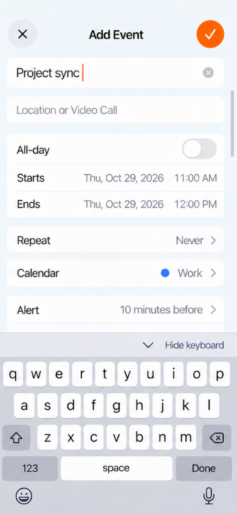

# Unified creation: design checkpoint

Status: design reference, 2026-10-29. These images are generated mockups, not
screenshots of implemented UI or evidence of device behavior. This checkpoint
changes documentation only. It does not replace the creation flow introduced
in PR #214.

## Adjacent iteration review

Compare each new iteration with the immediately preceding one: three previous
images and three current images. Round 4 establishes the aligned layout with
the keyboard dismissed. Round 5 explores explicitly tapping the name field and
opening the keyboard. Each exported image is 390 × 844 pixels.

| Iteration | Alarm | Reminder | Calendar event |
| --- | --- | --- | --- |
| Round 4 |  |  |  |
| Round 5 |  |  |  |

## Shared design rules

- Use one header pattern: circular close control on the left, centered
  `Add Alarm`, `Add Reminder` or `Add Event`, and an orange circular checkmark on
  the right. The checkmark explicitly submits the current draft.
- Put the name in an independent first section. Keep its typography, margins
  and height consistent across all three types.
- Use the same Repeat component for Alarm and Reminder: a readable summary,
  `Weekdays`, `Weekends` and `Every day` presets, and seven directly selectable
  weekday circles. Order weekdays according to the user's calendar settings.
  This weekly pattern does not impose a seven-day scheduling limit. Preserve
  other supported reminder recurrence choices when implementing the component.
- Use the same `Sound`, `Snooze` and `Snooze Duration` presentation for Alarm and
  Reminder. Remove Reminder's separate bell and Repeat utility icons; retain
  its List and Flag actions.
- Snooze behavior is explicitly confirmed: after the user taps Snooze, alert
  again after the selected duration. Weekly recurrence and this manual snooze
  interval are separate. Automatic repeated alerts until completion are outside
  this design.
- Align the header and name sections across all three types. Align the shared
  Repeat and sound/snooze groups across Alarm and Reminder. Event retains its
  own single-row Repeat and event-specific field structure.

The typography and spacing targets are a 17-point semibold header, 20-point
medium name, 17-point body, 44-point control targets, 20-point side margins,
16-point corners and 16-point section gaps. Raster mockups illustrate the
direction; these are not measured or verified SwiftUI dimensions.

## Preserve the type-specific tools

| Type | Existing tools to retain |
| --- | --- |
| Alarm | Expanded native time wheel, usual times, nap shortcuts, name suggestions, seven-day repeat and sound/snooze settings. |
| Reminder | Date summary and picker, day shortcuts, all twelve time-grid buttons, List and Flag, supported recurrence choices, and the requested shared repeat/snooze presentation. |
| Event | Location, all-day, start/end, recurrence, writable calendar selection, alerts, availability, URL and notes. |

Reminder's four-column time grid remains:

| 09:30 | 12:00 | 18:30 | 22:00 |
| --- | --- | --- | --- |
| +10 min | +1 hr | +3 hr | +1 day |
| −10 min | −1 hr | −3 hr | −1 day |

## Keyboard interaction target

1. Explicitly focusing a name opens the keyboard and shows the insertion point.
   This is not a requirement to automatically focus the name when opening every
   type of creation screen.
2. Keep the shared header and focused name visible. The settings below remain
   a scrollable form at their normal sizes. Lower settings continuing below the
   keyboard viewport have not been removed.
3. Use the same `Hide keyboard` accessory on all three screens. It dismisses the
   keyboard and retains the draft, selections and scroll position. The keyboard
   `Done` key has the same dismiss-only role; it does not create an item.
4. The header checkmark remains the explicit submit action. After keyboard
   dismissal, return to the full form represented by Round 4.

## Implementation boundaries and open validation

The mockups do not establish that Reminder's create/save pipeline already
persists or delivers the requested sound and snooze settings. Those capabilities
need an implementation and validation before being presented as working.

Event's shared header is a visual target. Customization of Apple's native
`EKEventEditViewController` has not been validated; do not use private APIs or
claim the system editor already supports this chrome. Resolve that constraint
while preserving the existing event creation and selection behavior.

Any later implementation must preserve explicit submission, duplicate-submit
protection, drafts on failure, real persistence receipts, Activity and Undo,
existing-item editors, calendar-slot and deep-link routes, and nonblocking alarm
authorization. This checkpoint does not authorize AI/model changes, broader
recurrence behavior, provisioning changes or phone installation.

Actual keyboard input, scrolling, dismissal, save behavior, accessibility,
Dynamic Type, dark mode, localization and physical-device usability have not
been tested for these designs.

## Provenance

The board was generated with ImageGen. The individual images are static HTML
window exports of the aligned boards; no app or device was used to capture
them. [manifest.json](manifest.json) records their hashes and dimensions.
Full prompts, intermediate boards and QA journal artifacts remain in the primary
checkout's `tests/results/designs/create-round4-20261029/` and
`tests/results/designs/create-round5-20261029/`. This compact checkpoint includes
only the six review images and the agreed design rules.
